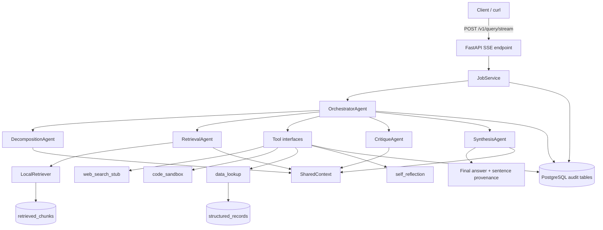

# Mega AI Multi-Agent LLM Orchestration Assignment

Real-time multi-agent orchestration and evaluation system for the Mega AI LLM Engineer take-home assignment.

The implementation is intentionally deterministic by default so reviewers can run it without paid LLM keys. It still models the production concerns the assignment asks for: dynamic orchestration, shared context, tool failure contracts, context budgets, multi-hop retrieval, critique, synthesis, prompt rewrites, SSE streaming, persistent traces, and reproducible eval runs.

## Quick Start

```bash
cp .env.example .env
make docker-up-build
```

Services:

- API: `http://localhost:8000`
- PostgreSQL: `localhost:5432`
- Adminer log/query UI: `http://localhost:8080`

These are the default host ports from `.env.example`. Change `API_HOST_PORT`,
`POSTGRES_HOST_PORT`, or `ADMINER_HOST_PORT` in `.env` if any local port is busy.

Adminer connection:

- System: PostgreSQL
- Server: `db`
- Username: `mega_ai`
- Password: `mega_ai`
- Database: `mega_ai`

Configurable host ports in `.env`:

```bash
API_HOST_PORT=8000
POSTGRES_HOST_PORT=5432
ADMINER_HOST_PORT=8080
```

To watch logs after startup:

```bash
make docker-logs
make docker-logs SERVICE=api
```

Raw Docker Compose also works. Use detached mode if you do not want logs attached:

```bash
docker compose up -d --build
docker compose logs -f --tail=100
```

## Local Development

Using Poetry:

```bash
poetry install
poetry run uvicorn mega_ai.main:app --reload
```

The repo uses a production-style Python service layout: app code lives under `src/mega_ai`,
database code under `src/mega_ai/db/pgv`, business logic under `src/mega_ai/service`,
SQLAlchemy models are split under `src/mega_ai/db/pgv/models`, Pydantic DB schemas live
under `src/mega_ai/db/pgv/schemas`, module-level CRUD lives under `src/mega_ai/db/pgv/crud`,
and the worker can be started from root `worker.py`.

Or using a plain virtual environment:

```bash
python3 -m venv .venv
.venv/bin/pip install -r requirements.txt
.venv/bin/pip install pytest pytest-cov httpx ruff mypy
.venv/bin/uvicorn mega_ai.main:app --reload
```

Run checks:

```bash
make check
```

Optional Alembic check with local SQLite:

```bash
DATABASE_URL=sqlite:///./mega_ai.db poetry run alembic upgrade head
```


## API Usage

The app intentionally exposes exactly five public `/v1` endpoints.

### Streaming Query

```bash
curl -N -X POST http://localhost:8000/v1/query/stream \
  -H "content-type: application/json" \
  -d '{"query":"Explain the Mega AI orchestrator behavior with sources."}'
```

The response is Server-Sent Events. Events include `job_started`, `orchestrator_decision`, `agent_started`, `agent_token`, `tool_call_started`, `tool_call_finished`, `tool_output_rejected`, `context_budget_update`, `final_answer`, and `job_finished`.

### Execution Trace

```bash
curl http://localhost:8000/v1/jobs/<job_id>/trace
```

Returns ordered trace events, agent executions, tool calls, prompt snapshots, hashes, latency, token counts, policy violations, and final provenance.

### Latest Eval

```bash
curl http://localhost:8000/v1/evals/latest
```

If no eval exists, the endpoint runs the deterministic 15-case harness and stores the result.

### Prompt Rewrite Approval

```bash
curl -X POST http://localhost:8000/v1/prompts/rewrites/<rewrite_id>/decision \
  -H "content-type: application/json" \
  -d '{"decision":"approve","reviewer_note":"Accept for targeted retry."}'
```

### Targeted Re-Eval

```bash
curl -X POST http://localhost:8000/v1/evals/targeted-rerun \
  -H "content-type: application/json" \
  -d '{}'
```

Runs previously failed cases, or the full set if there are no failed cases, using latest approved prompts.

## Architecture Diagram



## Agents

- Orchestrator: selects agents, tool plan, context budgets, and fallback path. It logs structured routing decisions.
- Decomposition: creates typed subtasks with dependencies.
- Retrieval: performs multi-hop local retrieval and cites at least two chunks.
- Critique: reviews claims from other agents and flags exact disagreed spans.
- Synthesis: resolves critique disagreements and produces sentence-level provenance.
- Compression: preserves structured data while compressing older filler when budgets require it.
- Meta prompt: proposes human-reviewable prompt rewrites after eval failures.

## Eval Harness

The eval harness contains 15 deterministic cases:

- 5 straightforward known-answer cases
- 5 ambiguous or underspecified cases
- 5 adversarial cases

Scores are local and inspectable:

- answer correctness
- citation accuracy
- contradiction resolution quality
- tool selection efficiency
- context budget compliance
- critique agreement rate

Each score stores a numeric value plus a written justification.

## Provider Strategy

This submission uses deterministic local agent behavior instead of paid LLM calls. That keeps setup reproducible and avoids hidden API-key requirements. The code is structured so real provider-backed agent calls can replace deterministic agent logic later without changing the API surface.

## AI Assistance Attestation

AI assistance was used to help scaffold and implement the assignment. The work was reviewed through local compilation, tests, linting, type checking, and manual smoke testing. No paid LLM provider keys or secret values are required by the submitted implementation.

## Known Limitations

- The code sandbox is a constrained demo wrapper around isolated Python mode, not a hardened production sandbox.
- The web search tool is a deterministic stub, not live internet search.
- The natural-language-to-SQL tool uses allowlisted patterns instead of arbitrary SQL generation.
- The background worker starts with Docker Compose and seeds durable state, but the streaming query path executes inline to preserve real-time SSE behavior in this MVP.
- Agent reasoning is deterministic and inspectable; replacing it with real LLM calls would require provider credentials, stronger retry controls, and additional eval drift monitoring.

## What I Would Build Next

- Real LLM provider adapters with prompt-version pinning.
- Stronger sandboxing using a separate locked-down container.
- Distributed job queue for long-running agent jobs and eval batches.
- OpenTelemetry traces and richer log query filters.
- More adversarial eval cases and regression snapshots in CI.
