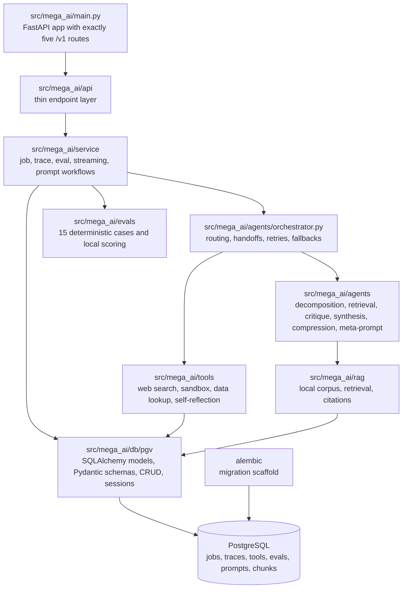

# Architecture Notes

This file is a shorter map for reviewers who want to inspect code quickly.

## Module Map

- `src/mega_ai/main.py`: FastAPI app with docs disabled and exactly five public routes.
- `src/mega_ai/api`: thin endpoint modules for query, jobs, evals, and prompts.
- `src/mega_ai/service`: job lifecycle, trace reconstruction, eval execution, streaming helpers, and prompt rewrite workflow.
- `src/mega_ai/agents/orchestrator.py`: dynamic routing, agent handoffs, tool retries, fallback decisions, and trace events.
- `src/mega_ai/agents`: deterministic agent implementations.
- `src/mega_ai/tools`: tool interfaces with explicit failure contracts.
- `src/mega_ai/evals`: deterministic eval cases and local scorers.
- `src/mega_ai/db/pgv/models`: table models split by domain.
- `src/mega_ai/db/pgv/schemas`: Pydantic create/update/output schemas for DB-facing boundaries.
- `src/mega_ai/db/pgv/crud`: module-level CRUD functions for jobs, traces, tools, evals, prompts, and seed data.
- `alembic`: migration scaffold wired to `mega_ai.db.pgv.models.Base.metadata`.
